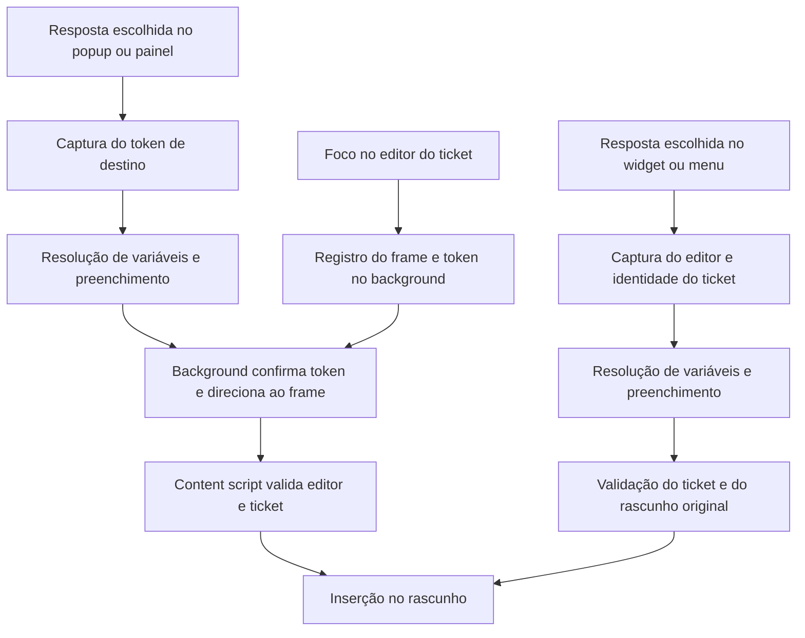

# Evolução do OctaBlaster

## Etapa 1 — Integração e dados existentes

| Mudança | Resultado esperado | Verificação |
| --- | --- | --- |
| Mensagens direcionadas | A interface envia a ação ao frame e editor identificados pela extensão. | Dois frames recebem comandos distintos, mensagens da página não inserem texto. |
| Isolamento por ticket | Detecção, inserção e menções usam o chamado de origem. | Texto de outro chamado e título global não influenciam a detecção. Troca de contexto interrompe uma ação pendente. |
| Evolução dos modelos padrão | Novos padrões chegam a instalações existentes, preservando personalizações e exclusões. | Primeira instalação, dados legados, repetição de migração, edição e exclusão de padrões. |
| Releases do fork | A verificação consulta TymotheoTrisch/octa-blaster. | Conferência do endereço consultado e comparação de versões. |

## Etapa 2 — Variáveis e respostas pelo teclado

Variáveis automáticas continuam disponíveis como `{{Saudacao}}`, `{{Data}}` e `{{Hora}}`. O cadastro permite valores salvos, como `{{Assinatura}}`, e valores solicitados a cada uso, como `{{Protocolo}}`. Popup, painel lateral, widget e menu do editor devem compartilhar a resolução. Cancelar o preenchimento encerra a operação antes de alterar o rascunho.

O menu do editor usa `\` inicialmente, com opção de `/` ou desativação. O gatilho no início da linha ou depois de espaço abre os títulos de respostas. Digitar filtra a lista. Setas navegam, Enter escolhe, Esc fecha e clique seleciona. A escolha substitui o gatilho e a busca pelo texto da resposta, mantendo a mensagem como rascunho. A inserção deve validar novamente o editor e o chamado de origem depois de qualquer preenchimento assíncrono.

## Execução e validação

Um agente implementa o código de produção, um segundo revisa os caminhos afetados e um terceiro desenvolve e executa as verificações independentes. A coordenação integra os achados antes da entrega.

As verificações incluem regressões automatizadas, tipos TypeScript e builds de Chrome e Firefox. O relatório de entrega distingue testes com fixtures do editor e validação em uma sessão real autenticada do Octadesk.

## Como usar

1. Abra o menu de três pontos no popup ou painel lateral e escolha **Variáveis**.
2. Selecione **Nova variável**, informe um nome como `Assinatura`, escolha **Valor salvo** e preencha o valor. Para dados que mudam a cada resposta, escolha **Preencher ao usar**.
3. Salve a variável. Nomes são únicos sem distinção entre maiúsculas e minúsculas. `Saudacao`, `Data` e `Hora` são reservadas.
4. Crie ou edite uma resposta. Os botões de variáveis automáticas e cadastradas inserem o token na posição do cursor ou substituem o trecho selecionado. Variáveis presentes no texto que ainda não foram cadastradas também são solicitadas no momento do uso. Ao renomear uma variável, atualize os tokens das mensagens para o novo nome.
5. Clique no campo de resposta do ticket. Digite `\` e parte do título da resposta. Cada item apresenta a prévia abaixo do título, usando a mesma lista, ordem e renderização do botão **Respostas**. Escolha com as setas e Enter ou clique no título. O texto fica no rascunho.
6. Para usar `/` ou desativar o menu, abra **Atalhos** no menu da extensão. Nessa tela também é possível cadastrar, editar, desativar e remover os técnicos das menções de licenças.

A tela **Tags**, acessível pelo menu, centraliza os nomes usados para organizar as mensagens. As categorias antigas aparecem nesse cadastro. Uma mensagem pode receber várias tags, selecionadas no formulário, e a lista pode ser filtrada por tag. Renomear uma tag atualiza seu nome nas mensagens associadas. Excluir uma tag remove suas associações.

No formulário, **Selecionar tags** abre um menu com as opções de seleção múltipla. Na lista de mensagens, o filtro de tags fica ao lado da busca. A seta de voltar dos formulários de cadastro retorna à lista daquele cadastro. A seta da lista retorna à tela visitada anteriormente.

A exportação JSON inclui mensagens e o catálogo de tags. A importação aceita esse formato e os arquivos antigos com listas de modelos e categorias.

Popup, painel lateral, widget e menu pedem os valores pendentes em um formulário. Cancelar preserva o rascunho. A seleção no menu substitui apenas o gatilho e o trecho de busca. Se o ticket mudar ou o rascunho for editado durante esse formulário, a inserção pendente é descartada.

## Fluxo de inserção



## Comandos de verificação

```powershell
pnpm test
pnpm compile
pnpm build
pnpm build:firefox
```

A suíte usa os hooks de módulos do Node.js e o jsdom. A versão instalada do jsdom exige Node.js 22.22.2+, 24.15+ ou 26+. O CI usa a versão mais recente da linha Node.js 22 e executa testes, tipos e os dois builds. Os pacotes para carregar no navegador ficam em `.output/chrome-mv3` e `.output/firefox-mv2`.

## Pontos que dependem do DOM do Octadesk

A extensão reconhece contêineres de ticket pelos seletores em `utils/licenseDetector.ts`. Editores em frames de mesma origem podem usar o contêiner do ticket no documento pai. Frames de outra origem precisam de um contêiner reconhecido no próprio documento.

A seleção de responsáveis aceita popovers dentro do ticket e portais associados ao editor por atributos ARIA. Um portal sem essa associação exige conferir o DOM real antes de definir como vinculá-lo ao chamado. O teste final em uma sessão autenticada deve incluir anotação interna, menções, vários tickets abertos e os editores efetivamente usados pela equipe.

## Resultado da validação em 17/11/2026

- 30 testes automatizados aprovados, cobrindo migrações, alterações concorrentes, mensagens direcionadas, variáveis, atalhos, cancelamento, composição de texto, iframes ocultos e bloqueio de menções na resposta pública.
- Checagem TypeScript e builds de Chrome e Firefox aprovados.
- Extensão carregada no Chromium validou menu em textarea e iframe, armazenamento e background reais, além da rejeição de comando direcionado a iframe oculto.
- Interface Vue do popup validada em viewport de 380 × 540 com APIs simuladas, incluindo cadastro de duas variáveis, configuração de `/`, rolagem, salvamento e acesso à lista de respostas.

O popup nativo no Chromium headless não ofereceu um alvo acessível à automação. O fluxo do popup foi coberto pelos testes de mensageria e pela interface Vue com APIs simuladas. A integração com uma sessão autenticada do Octadesk e a execução no Firefox permanecem sem verificação funcional. O build do Firefox foi validado.

## Integração com a versão 0.7.0

A branch `codex/integracao-0.7.0` integra a `main` de `luizGDpulz/octa-blaster` no commit `054b298`, com os cards em acordeão, ações compactas e reordenação de modelos. As variáveis configuráveis, atalhos no editor, isolamento por ticket, migrações e consulta de atualizações do fork continuam disponíveis.

A gravação distingue reordenação intencional de edição do conteúdo. Editar um modelo em um painel aberto antes de uma reordenação preserva a ordem mais recente. Novos modelos criados por outro painel também são preservados.

A integração passou em 32 testes, na checagem TypeScript e nos builds de Chrome e Firefox. O Chromium com a extensão carregada e APIs reais validou os cards em acordeão, reordenação por teclado e arraste, persistência após recarregar, cancelamento com Esc, pesquisa e configurações de variáveis e atalhos. As páginas de ticket usadas nos testes foram fixtures locais. A sessão autenticada do Octadesk permanece sem verificação.

## Telas de gerenciamento em 18/11/2026

O menu passa a abrir as telas **Variáveis**, **Tags** e **Atalhos**. O cadastro de técnicos fica na tela de atalhos. O formulário de mensagem apresenta todas as variáveis e permite escolher várias tags. O rascunho e a posição de inserção são preservados ao navegar para os cadastros e voltar.

A marcação de técnicos aguarda até 15 segundos por pessoa entre a busca das sugestões e a confirmação do marcador no editor. A próxima busca começa após a confirmação. Marcadores já presentes são reconhecidos em uma nova tentativa. A troca de ticket ou o desaparecimento do editor interrompe a espera. Os testes incluem sugestões lentas, renderização atrasada do marcador e um clique que não produz marcação.

A busca do técnico é inserida em uma única operação. No HTML nativo do Octadesk, a confirmação verifica o nome em `<person>` com `personid` preenchido, sem depender do tamanho visual da etiqueta. Se a etiqueta aparecer antes de receber o identificador, a rotina continua aguardando antes de buscar o próximo técnico. Se a seleção acontece no primeiro evento do mouse, a rotina evita um segundo acionamento. O cursor é posicionado fora do marcador antes da próxima busca.

Essa versão passou em 57 testes automatizados, na checagem TypeScript e nos builds dos dois navegadores. O teste com a extensão carregada no Chromium cobriu o cadastro e a edição das variáveis, inserção de tokens na seleção, filtro de tags, persistência, configuração dos técnicos e uso desses técnicos na automação de uma página de teste. Popup e painel lateral foram conferidos em 380 × 540. A sessão autenticada do Octadesk no Firefox continua dependendo de validação nesse ambiente.
